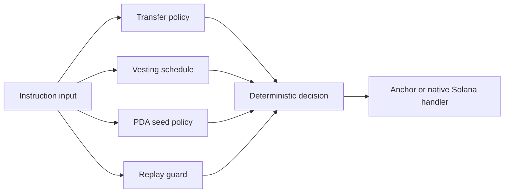

# Solana Safety Lab

<p align="center">
  <strong>Small, auditable Rust guardrails for Solana program design.</strong><br>
  Validate transfer policy, vesting math, PDA seeds, and replay protection before those rules reach an on-chain instruction.
</p>

<p align="center">
  <a href="https://github.com/MrBoodj011/solana-dev/actions/workflows/ci.yml"></a>
  <a href="LICENSE"></a>
  
  
</p>

Solana Safety Lab is a dependency-free Rust crate for testing security-critical rules away from RPC, wallets, and network state. It is intentionally narrow: these primitives complement Anchor or native Solana programs; they do not pretend to deploy, sign, or audit a program for you.

## What is implemented

| Module | Guarantee |
| --- | --- |
| `transfer` | Authority, mint, destination, pause, per-transfer, and daily-limit validation with checked arithmetic |
| `vesting` | Deterministic cliff and linear vesting calculations using widened integer math |
| `pda` | Strict seed-count and seed-length validation before PDA derivation |
| `replay` | Bounded in-memory nonce window with duplicate and zero-nonce rejection |



## Quick start

```bash
git clone https://github.com/MrBoodj011/solana-dev.git
cd solana-dev
cargo test
cargo run --example policy_demo
```

```rust
use solana_safety_lab::{TransferPolicy, TransferRequest};

let authority = [7_u8; 32];
let mint = [9_u8; 32];
let policy = TransferPolicy::new(1_000, 5_000)?;
let next_total = policy.validate(&TransferRequest {
    signer: authority,
    expected_authority: authority,
    source_mint: mint,
    expected_mint: mint,
    destination: [3_u8; 32],
    amount: 750,
    already_spent_today: 1_000,
})?;

assert_eq!(next_total, 1_750);
# Ok::<(), solana_safety_lab::TransferError>(())
```

## Security model

- `#![forbid(unsafe_code)]` is enabled for the crate.
- Every amount calculation is checked or widened before multiplication.
- Invalid policy is rejected at construction time.
- Errors are explicit and stable enough for instruction-level mapping.
- Tests cover zero values, boundaries, overflow, replay, and invalid schedules.
- The crate performs no RPC calls, key management, signing, or hidden I/O.

This library is not a substitute for account ownership checks, signer checks, rent rules, CPI validation, program upgrade governance, fuzzing, or an independent audit. Map these pure rules into your on-chain account model and test that integration separately.

## Repository layout

```text
src/
  lib.rs       Public API and shared address type
  transfer.rs  Transfer authorization and limits
  vesting.rs   Cliff and linear vesting math
  pda.rs       Seed policy validation
  replay.rs    Bounded nonce replay guard
tests/         Public-API integration tests
examples/      Runnable policy example
```

## Development

```bash
cargo fmt --check
cargo clippy --all-targets --all-features -- -D warnings
cargo test --all-features
cargo doc --no-deps
```

See [CONTRIBUTING.md](CONTRIBUTING.md), [SECURITY.md](SECURITY.md), and [CODE_OF_CONDUCT.md](CODE_OF_CONDUCT.md) before contributing.

## Author and license

Created and maintained by [Reda Adjar (MrBoodj011)](https://github.com/MrBoodj011), founder of Cybrense IT Services. Released under the [MIT License](LICENSE).
